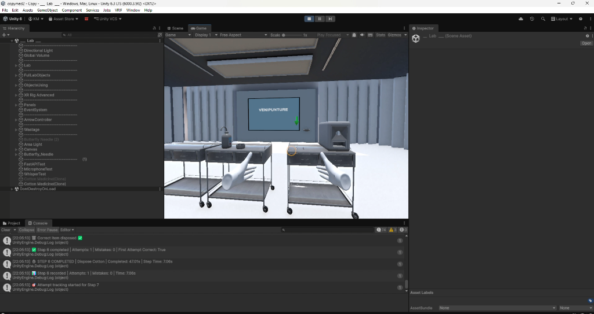
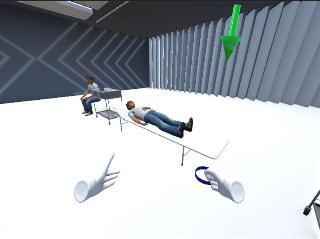
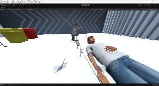
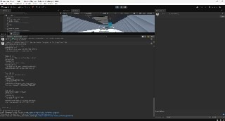

# 🥽 Magesh K — Unity VR Developer Portfolio

<div align="center">

[](https://magesh-03-k.github.io/magesh-vr-portfolio/)
[](./Magesh_K_Resume.pdf)
[](https://www.linkedin.com/in/magesh03)
[](https://my-portfolio-dmt1.vercel.app/)

<p align="center">
  <b>Interactive VR Applications · Procedural Simulation Systems · Offline AI Voice Integration</b>
</p>

[**Explore Live Website**](https://magesh-03-k.github.io/magesh-vr-portfolio/) •
[**View Featured Project**](#-featured-project-vr-venipuncture-training--assessment-system) •
[**Project Gallery**](#-project-gallery) •
[**Technical Skills**](#-technical-skills) •
[**Contact**](#-get-in-touch)

---

</div>

## 📌 Overview

Welcome to the repository for **Magesh K's VR Developer Portfolio**. This website showcases interactive virtual reality simulations, procedural training workflows, realistic physics-based interactions, and AI-assisted experiences developed with **Unity 6**, **C#**, and the **BNG Interaction Framework**.

### 🌟 Quick Links
* **Live Demo**: [https://magesh-03-k.github.io/magesh-vr-portfolio/](https://magesh-03-k.github.io/magesh-vr-portfolio/)
* **Download Resume**: [`Magesh_K_Resume.pdf`](./Magesh_K_Resume.pdf)
* **Email**: [mageshkubendren1981@gmail.com](mailto:mageshkubendren1981@gmail.com)
* **GitHub**: [@Magesh-03-K](https://github.com/Magesh-03-K)
* **LinkedIn**: [linkedin.com/in/magesh03](https://www.linkedin.com/in/magesh03)

---

## 👨‍💻 About Me

I am an **Artificial Intelligence and Data Science** undergraduate at **Prathyusha Engineering College** with a deep passion for **Extended Reality (XR)**, immersive training simulations, and interactive 3D computing.

My focus centers on:
- Designing modular, event-driven VR architecture in **Unity** and **C#**.
- Implementing realistic medical and procedural interactions with fine-grained collision detection and snap zones.
- Building deterministic state validation, timing logic, and structured JSON telemetry export.
- Integrating offline AI systems (local speech-to-text with **Whisper** and text-to-speech with **Kokoro TTS**) via lightweight **FastAPI** microservices to keep VR environments responsive and cloud-independent.

---

## 🏆 Featured Project: VR Venipuncture Training & Assessment System

> **Platform:** Meta Quest 3 / PCVR · **Engine:** Unity 6 LTS · **Language:** C# · **Framework:** BNG Interaction Framework · **AI Stack:** FastAPI, Whisper, Kokoro TTS

An immersive medical training application designed to train and assess healthcare students on a predefined **16-step venipuncture procedure** inside a sterile virtual clinic.

```
┌────────────────────────────────────────────────────────────────────────┐
│                   VR Venipuncture Simulation Pipeline                  │
├─────────────────┬─────────────────┬──────────────────┬─────────────────┤
│ 1. Interaction  │ 2. Procedure    │ 3. Dual-Mode     │ 4. Analytics    │
│    Layer        │    Manager      │    Assessment    │    & Export     │
│                 │                 │                  │                 │
│ • BNG Grabbables│ • State Machine │ • Guided Training│ • Step Timers   │
│ • Snap Zones    │ • 16-Step Logic │ • Blind Testing  │ • Mistake Count │
│ • Needle Triggers│• Order Check   │ • Dynamic Hints  │ • JSON Telemetry│
└─────────────────┴─────────────────┴──────────────────┴─────────────────┘
```

### 🔑 Personal Contributions & Core Engineering

1. **Procedural Task Management & Validation**
   - Built the finite-state machine governing the mandatory 16 sequential steps (from tourniquet application and vein palpation to needle insertion, tube vacuum draw, and post-draw care).
   - Linked physical collision triggers and hand-grab events directly into the procedural state controller.

2. **VR Interaction Systems (BNG Framework)**
   - Configured high-fidelity medical grab mechanics, physics constraints, socket/snap zones for tubes, and syringe plunge triggers.
   - Designed anatomical arm colliders and vein target zones for precise needle insertion angles and depth validation.

3. **Dual Execution Modes (Training vs. Test)**
   - **Training Mode:** Real-time 3D spatial arrows, visual HUD cues, audio prompts, and floor indicators guiding trainees step-by-step.
   - **Test Mode:** Guidance disabled for independent execution. Tracks erroneous actions, out-of-order attempts, and procedural violations in real time.

4. **Performance Tracking & Analytics**
   - Granular metrics recorded per session: total elapsed time, per-step completion duration, first-attempt accuracy, mistake counts, and failure points.

5. **Structured JSON Telemetry Export**
   - Engineered an offline JSON serialization module saving comprehensive session records locally on the headset/PC without requiring third-party cloud analytics.

6. **Offline AI Voice Assistant *(In Progress)***
   - Architected local microservice communication between Unity and a background **FastAPI** service running **Whisper STT** and **Kokoro TTS** for natural voice feedback without cloud latency.

---

## 📸 Project Gallery

| Simulation Environment | Guided Training Mode |
| :---: | :---: |
|  |  |
| *Medical equipment, procedural trolley, and sterile clinic environment in Unity 6.* | *Step-by-step instructional prompts and 3D visual navigational cues.* |

| VR Object Interactions | Telemetry & Assessment Logs |
| :---: | :---: |
|  |  |
| *Realistic hand interactions, tourniquet binding, and needle alignment validation.* | *Structured test results, mistake logs, step timers, and JSON export.* |

---

## 🛠️ Technical Skills

| Domain | Technologies & Competencies |
| :--- | :--- |
| **XR & VR Engines** | Unity 6, Unity 2022 LTS, C#, OpenXR, Meta Quest SDK, BNG Interaction Framework |
| **Simulation Architecture** | State Machines, Event-Driven Architecture, Task Validation, Real-Time Telemetry |
| **Physics & Interactions** | Physics Raycasting, Colliders, Trigger Volumes, Snap Zones, Hand Tracking |
| **AI & Backend** | Python, FastAPI, Whisper (STT), Kokoro (TTS), REST APIs, JSON Serialization |
| **Web & Graphics** | Three.js (WebGL), Modern HTML5/CSS3, JavaScript |
| **Developer Tools** | Git, GitHub, Visual Studio, Visual Studio Code, Unity Profiler |

---

## 🚀 Other Projects

### 🏥 VR Medical Simulation Platform
- **Stack:** Unity · C# · BNG Framework
- A modular architecture built to host multiple medical scenarios with reusable VR interaction components, UI Toolkit overlays, and standardized session scoring.

### 🎙️ Offline Voice Assistant
- **Stack:** Python · Vosk / Whisper · FastAPI · Speech Processing
- Low-latency speech recognition and voice command parsing without cloud dependencies, serving as the blueprint for in-headset VR assistants.

---

## 💻 Local Development & Setup

To view and run this portfolio website locally on your computer:

### 1. Clone the repository
```bash
git clone https://github.com/Magesh-03-K/magesh-vr-portfolio.git
cd magesh-vr-portfolio
```

### 2. Run with a local HTTP server

You can use any local web server. For example:

**Using Python 3:**
```bash
python -m http.server 8000
```
Open [http://localhost:8000](http://localhost:8000) in your browser.

**Using VS Code Live Server:**
1. Install the **Live Server** extension in VS Code.
2. Right-click [`index.html`](./index.html) and select **"Open with Live Server"**.

**Using Node / `npx serve`:**
```bash
npx serve .
```

---

## 📂 Repository Structure

```text
magesh-vr-portfolio/
├── index.html                   # Responsive portfolio webpage with Three.js hero animation
├── Magesh_K_Resume.pdf          # Downloadable resume
├── README.md                    # Project documentation & portfolio showcase
│
└── images/                      # High-resolution simulation screenshots
    ├── simulation-environment.png
    ├── training-mode.jpg
    ├── object-interactions.jpg
    └── assessment-data.jpg
```

---

## 🎓 Education

- **Bachelor's Degree in Artificial Intelligence & Data Science**
  - *Prathyusha Engineering College*
  - Focus: Software development, computer vision, AI systems, and immersive extended reality applications.

---

## 📬 Get in Touch

I am open to **Unity / VR Developer roles, internships, and project collaborations**. Let's build something immersive together!

- 🌐 **Live Portfolio:** [magesh-03-k.github.io/magesh-vr-portfolio](https://magesh-03-k.github.io/magesh-vr-portfolio/)
- 💼 **Software Portfolio:** [my-portfolio-dmt1.vercel.app](https://my-portfolio-dmt1.vercel.app/)
- 💼 **LinkedIn:** [linkedin.com/in/magesh03](https://www.linkedin.com/in/magesh03)
- 🐙 **GitHub:** [github.com/Magesh-03-K](https://github.com/Magesh-03-K)
- ✉️ **Email:** [mageshkubendren1981@gmail.com](mailto:mageshkubendren1981@gmail.com)

---

<div align="center">
  <sub>Built with ❤️ by <b>Magesh K</b> · Powered by GitHub Pages</sub>
</div>
